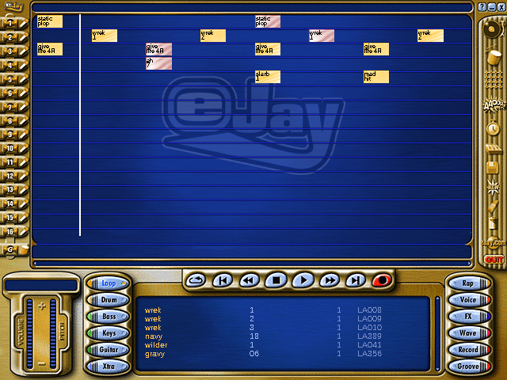
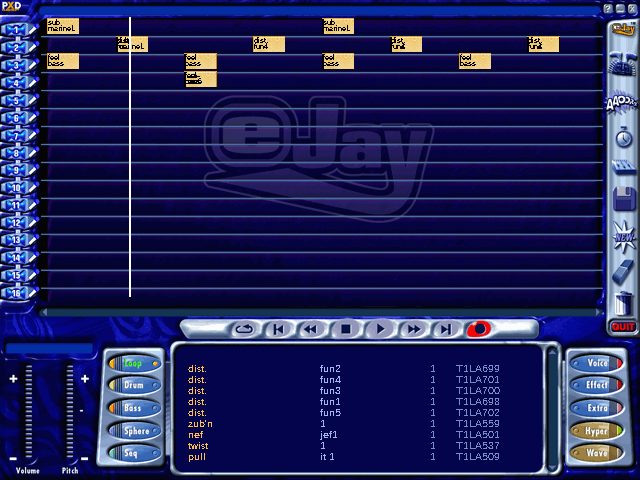
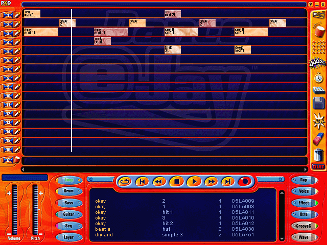
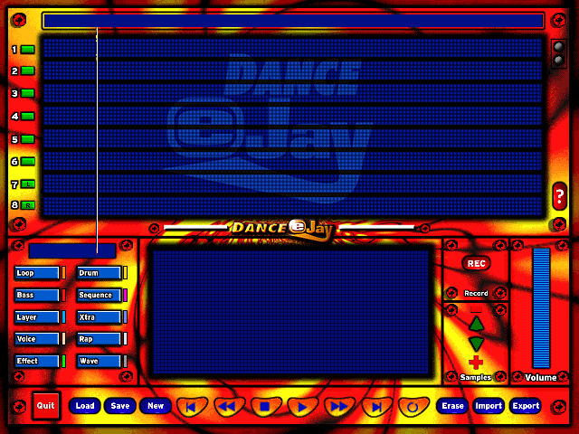

# eJay static recompilation

Static recompilation of **Dance eJay** (1997) and the **eJay 2** family - Dance
eJay 2, HipHop eJay 2 and Techno eJay - the loop-and-drop music studios that
taught a generation what a bar was. Each title's own audio engine and graphics
DLL are driven by a host of ours, natively on Windows and recompiled to C on
Linux and macOS. You bring the disc.

Part of the [pcrecomp](https://github.com/sp00nznet/pcrecomp) family, and
follows its house style: the toolkit ships, nothing from a disc ever does.

## Status

**v0.1.0, alpha.** The eJay 2 titles open their workspace with a demo
arrangement in their own sounds; you can browse each title's sample library,
double-click a sample into the arrangement and drag blocks along their lanes,
and it plays in time. The transport, load and save buttons light up and do
nothing yet, and saved songs (`.MIX`) cannot be opened yet - see the
[ROADMAP](ROADMAP.md).

| Title | Windows | Linux | macOS |
|---|---|---|---|
| Dance eJay 2 (1999) | plays | plays | plays |
| HipHop eJay 2 (2000) | plays | plays | plays |
| Techno eJay / Rave eJay 2 (2000) | plays | plays | plays |
| Dance eJay 3 (2000) | draws, silent | draws, silent | - |
| Dance eJay (1997) | engine recompiled; the intro streams, placed samples are silent | - | - |

Run on Windows 11, Debian 13 (x86-64) and macOS 15 (x86-64). An Apple silicon
Mac builds the same 64-bit way and has not been run.

Format conformance against seven discs (`tools/conform.py`): **120,645 passed,
158 failed** - the failures are known and listed under "Checking your disc".

## Screenshots


*Dance eJay 2's workspace on Windows, playing a demo arrangement from its own
library: thirteen blocks in its marbled textures with the samples' own names,
the browser on the disc's Loop group, the playhead sweeping in time.*

| | |
|---|---|
|  |  |
| *HipHop eJay 2 on Linux, at its own 90 BPM* | *Techno eJay on Linux* |
|  |  |
| *Dance eJay 2 on macOS* | *Dance eJay 1's recompiled engine streaming its intro* |

## Getting Started

You need an eJay 2 disc - Dance eJay 2, HipHop eJay 2, or Techno eJay (Rave
eJay 2) - or its `.iso`, and about 2 GB free. Nothing from the disc is in this
repository or downloaded from anywhere; setup copies it from yours.

### Quick start

**The installer.** Download `eJay-2-Installer` for your system from the
[latest release](https://github.com/sp00nznet/ejay/releases/latest), open it,
point it at your disc (or the folder with the `.iso`), and press **Build**. It
fetches this repository and pcrecomp, runs the setup below, and leaves a
**Play** button. The installers are not signed: Windows SmartScreen asks (**More
info**, **Run anyway**); on a Mac, open it once, then **Open Anyway** in System
Settings, Privacy & Security.

**Or from a download of this repository**, with
[pcrecomp](https://github.com/sp00nznet/pcrecomp) unpacked beside it as
`pcrecomp`:

- **Windows:** double-click `Setup.cmd`. It finds a disc in a drive, or run
  `Setup.cmd -Game D:\` / `Setup.cmd -Game C:\Downloads\Dance_eJay2.iso`. If
  Visual Studio's C++ build tools are missing it offers to install them (about
  3 GB, with one admin prompt).
- **Linux, macOS:** `./setup.sh` finds a mounted disc, or
  `./setup.sh --game-dir /path/to/the.iso`. If something is missing it says
  what, with the command for your system; on a Mac it installs it with
  Homebrew.

Both end with a launcher beside them - `Dance eJay 2 (recomp).cmd`,
`HipHop eJay 2 (recomp).sh`, `Techno eJay (recomp).command` - that opens the
workspace. Run setup again with another disc to add that title. A rerun skips
the finished steps; a failure ends with one line saying what to do, and the
details are in `setup.log`.

### Step by step

What setup does, by hand.

1. **Prerequisites.**
   - Windows 10 or 11, and Visual Studio 2019 or newer (or its Build Tools)
     with *Desktop development with C++*.
   - Linux: gcc, CMake 3.20+, Ninja, pkg-config, SDL2 and SDL2_ttf (dev
     packages), the Liberation fonts, Python 3 with `pefile` and `capstone`.
     Debian or Ubuntu:
     ```
     sudo apt install build-essential cmake ninja-build pkg-config libsdl2-dev libsdl2-ttf-dev \
                      fonts-liberation python3-pefile python3-capstone
     ```
   - macOS: Xcode's command line tools and Homebrew, then
     `brew install cmake ninja pkgconf sdl2 sdl2_ttf python` and
     `python3 -m pip install pefile capstone` (in a venv if Homebrew's Python
     refuses).
   - Off Windows, a checkout of pcrecomp beside this one:
     `git clone https://github.com/sp00nznet/pcrecomp ../pcrecomp`.

2. **Copy the title off the disc.** Two folders: the program folder (the one
   holding `PXD32CL1.DLL`) and the sample library (a folder holding an `.INF`
   and the archive of the same name, usually `PXD` on the disc):

   | Title | Program folder | Library |
   |---|---|---|
   | Dance eJay 2 | `D_ejay2\ejay` | `D_ejay2\PXD` |
   | HipHop eJay 2 | `eJay\eJay` | `eJay\pxd` |
   | Techno eJay | `EJAY\EJAY` | `EJAY\PXD` |

   ```
   game/dance2/program/    <- D_ejay2\ejay
   game/dance2/PXD/        <- D_ejay2\PXD
   ```

3. **Linux and macOS: lift the two DLLs to C** (about 20 seconds):
   ```
   python3 tools/lift_ejay2.py game/dance2/program dance2
   ```
   ```
     engine PXD32D4.DLL at 0x10000000: 963 functions, 0 errors, 9s
     gfx    PXD32CL1.DLL at 0x10100000: 1577 functions, 0 errors, 7s
   ```
   This writes `work/dance2/` and `src/recomp/dance2/`, derived from your disc's
   DLLs and never committed. Use the title ids `dance2`, `hiphop2`, `techno`.

4. **Build.**
   - Windows: `host\build.bat` -> `build-windows\ejay2.exe` (one build serves
     every title).
   - Linux, macOS:
     ```
     cmake -S host -B build-dance2 -G Ninja -DEJAY_TITLE=dance2
     cmake --build build-dance2
     ```

5. **Run it**, from the program folder:
   ```
   cd game/dance2/program
   ../../../build-dance2/ejay2 --lib ../PXD --song --ticks 0
   ```
   HipHop eJay 2 adds `--engine pxd32h4.dll --pal hh2`; Techno eJay
   `--engine PXD32R4.DLL --pal RAVE2`. You should see the workspace with
   thirteen blocks, the browser and a sweeping playhead, and hear the
   arrangement. The console says what loaded:
   ```
     engine layout              -> tracks 100429C8, mixer flag 1003AC68 (PXD32D4)
     sample library             -> 3290 samples in 10 groups under D:, a bar is 302400 (140 BPM)
     page Hauptbild             -> 111 controls
     APlay x13 across 13 tracks
     mixer armed -> audio on
   ```

**Usual trip-ups.** On Windows, `python` can be the Microsoft Store's alias
rather than Python (setup does not need Python on Windows). On Debian and
Ubuntu, `pip install` outside a venv is refused: use the `python3-pefile` and
`python3-capstone` packages. The Linux build does not need 32-bit libraries: it
is a 64-bit program. **Sound starts muted and low** on purpose (`--volume`,
default 20): the engine's buffer is noise until its mixer arms, and the output
stays muted until it does.

### Checking your disc

```
python tools/conform.py --root <the folder holding your discs>
```

checks every sample, control table, library index, `.INF` archive and saved
arrangement it finds against what the host relies on, and prints a pass/fail
count. Against Dance eJay 1, Dance eJay 2, HipHop eJay 2, Techno eJay, Rave eJay
2, Dance eJay 3, Rave eJay 1 and the Dance eJay Superpack: **120,645 passed, 158
failed**. The failures are real and known: `METRO.PXD` is a plain RIFF WAV on
every disc; the intros are songs, not loops; a handful of library samples are
genuinely not a whole number of beats; and the 1997-generation discs' control
tables and arrangements are an older format the host does not read. CI runs it
with no disc and gets nothing to check; it fails a local run only if the count
gets worse.

## Usage

```
# the workspace, held open until you close the window
ejay2 --lib ../PXD --song --ticks 0

# one library sample alone at bar 0, for listening to it
ejay2 --lib ../PXD --song --sample 120 --ticks 0

# checks that need no mouse and no ears
ejay2 --lib ../PXD --song --selftest --paintcheck --dragtest --ticks 200

# Linux and macOS without a screen or speakers; disk writes what the mixer made
SDL_AUDIODRIVER=disk SDL_DISKAUDIOFILE=out.raw ejay2 --headless --lib ../PXD --song --ticks 1000

# Windows: where the playhead is when a beat leaves the sound card
ejay2 --lib ../PXD --song --onset 4 --shot out --ticks 900

# Dance eJay 2's start-up system check
ejay2 --ticks 900
```

`--shot FILE` saves the window as a BMP at the end; `--frames N` every N ticks.
`--verbose`, `--tracks` and `--trace` (every Win32 call, off Windows) report
what the engine is doing. `--latency MS` backs the playhead off by your card's
output delay.

## Building from source

The eJay 2 host is above (step by step). How it is put together:
[PORTING](docs/PORTING.md) for the one-source, three-systems design and what
pcrecomp's win32hle needed; [TITLES](docs/TITLES.md) for the family and what
differs between titles; [EJAY2](docs/EJAY2.md) for how the engine and the
graphics DLL were worked out from `Dancejay.exe`'s own calls.

**Dance eJay 1's engine** is a different build: the 16-bit `DANCE02.DLL` lifted
whole to C (30,904 bytes into 1,244 functions) on a Win16 shim, with MinGW-w64
GCC, CMake, Ninja and Python. [ENGINE](docs/ENGINE.md) is the story so far.

```bash
cp original/ejay1/DANCE/DMACHINE/DANCE02.DLL work/
python tools/lift_dance02.py        # 30,904 bytes -> 1,244 C functions
python tools/gen_image.py           # flat memory image + segment layout
python tools/gen_exports.py         # the 34 named entry points
python tools/gen_win16_stubs.py     # the import surface
python tools/gen_segments_h.py
python tools/gen_dispatch.py
python tools/gen_stubs.py
cmake -S . -B build -G Ninja -DCMAKE_C_COMPILER=gcc
cmake --build build
build/ejay.exe --dir original/ejay1/DANCE/DMACHINE    # LibMain + export list
python tools/test_engine.py                           # the smoke test
```

`-O2` is a correctness requirement: the lifter turns every intra-segment jump
into `target(cpu); return;`, so a guest loop spanning lifted functions is host
recursion, and only sibling-call optimisation turns it back into a loop.
[RECON](docs/RECON.md) is what is on the discs and why the two generations are
one engine.

## Legal

No disc content is in this repository or produced by it for anyone else:
setup copies your own disc into a gitignored folder, and the generated C stays
on your machine. Dance eJay is © 1997, Dance eJay 2 © 1998-1999, HipHop eJay 2,
Techno eJay and Dance eJay 3 © 2000 PXD Musicsoft / Fast Trak / eJay AG; the
audio DLLs are © Bernhard Throll / THROLL GmbH. All long out of print; bring
your own discs.

## License

The code in this repository is MIT licensed. See [LICENSE](LICENSE).
